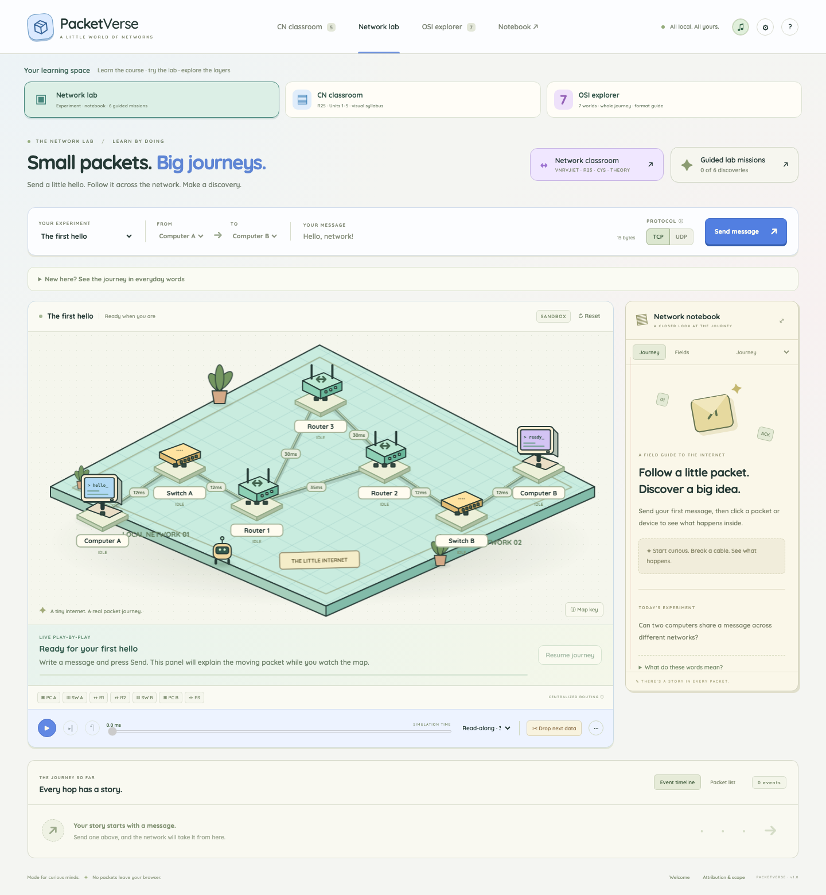

# PacketVerse

**Small packets. Big journeys.** An interactive network laboratory built with TypeScript, Vite, semantic HTML, and procedural Canvas 2D. Send a message through a miniature network, inspect real simulated headers, break a link, and watch what happens next.



## Run locally

Use **Node.js 24.x** and npm. From this directory:

```sh
npm ci
npm run dev
```

Open the URL Vite prints, normally **http://127.0.0.1:5173**. No API keys, backend, account, database, or runtime libraries are needed.

```sh
npm run typecheck
npm test
npm run build
npm run preview
```

The production build is in `dist/`. The updated lockfile resolves the upstream Vite advisory while retaining the existing dependency range. `npm audit` reports zero vulnerabilities at verification.

## Explore

1. Open the sandbox or choose one of six chapters from the learning trail.
2. Choose Computer A or B as sender, the other as receiver, TCP or UDP, and enter a message (up to 512 UTF-8 bytes).
3. Send. Parcels travel between actual device ports. Click a device, moving parcel, timeline event, or accessible packet-list entry.
4. Use the Network Notebook for encapsulation, packet fields, forwarding routes, switch MAC learning, ARP caches, TCP events, metrics, and explanations.
5. Pause, step an event, change playback speed, scrub, or replay. Selection remains pinned until **Follow live**.
6. Drop the next data frame; use the `···` fault menu to drop an ACK, toggle links, or change propagation delay. Settings expose seeded random loss, TTL, MSS, retry timeout, and out-of-order arrival.
7. Export/import versioned scenario JSON in Settings. Clear saved preferences and learning progress explicitly there.

On phones, swipe the network scene sideways or use the device and packet lists. Other panels stack vertically. All controls are keyboard accessible. Space toggles playback outside forms/dialogs; Escape closes a dialog. Reduced motion keeps inspection and event information available. Audio is muted by default and starts only after a user gesture.

## Included experiments

- Successful TCP delivery with SYN → SYN-ACK → ACK, ARP, switching, and routed IP forwarding.
- One-shot data loss and timeout recovery.
- Lost acknowledgement and duplicate handling.
- UDP delivery with a missing datagram and no automatic recovery.
- Disabled primary link with a longer routed alternative.
- No available routed path.
- Out-of-order TCP delivery and buffering.
- TTL expiry.
- Increased link propagation delay.

The six chapters track actual event-backed objectives. Opening a chapter alone never completes it. Progress and selected preferences use the `packetverse.v1.*` local-storage namespace.

## Architecture

```text
src/network/              Pure types, addressed topology, routing, heap scheduler, simulation
src/art/network/          Original procedural network illustrations and cached scene
src/engine/               Playback of immutable simulation events
src/ui/                   Notebook rendering from event snapshots
src/scenarios/            Experiments and event-backed lesson objectives
src/styles/               Responsive paper-and-ink interface
src/main.ts               Semantic controls, interaction, persistence, single animation loop
tests/network/            Protocol, routing, determinism, queue and playback tests
reference/                Preserved upstream source and original README for provenance
```

The discrete-event scheduler is independent of Canvas, audio, the DOM, and wall-clock time. It orders work by simulated milliseconds, then stable insertion order. A seeded generator determines per-link IP-frame loss. Each event retains its actual packet/frame fields, metrics, delivered bytes, and table snapshot. Rendering consumes these events without changing protocol behavior.

Timed interventions replay the deterministic simulation with an additional fault at the current simulated timestamp. Reset clears the trace and selection; Send starts a fresh simulation. Scenario/settings changes reset playback before applying new network settings. See [ARCHITECTURE.md](docs/ARCHITECTURE.md) for protocol decisions and [SIMULATION_SCOPE.md](docs/SIMULATION_SCOPE.md) for limitations.

## Verification

`npm test` covers shortest paths, longest prefixes, no-route failure, ARP and switch learning, routed Ethernet changes, TTL, multibyte reconstruction, one-shot data loss, lost ACKs, duplicates, out-of-order buffering, UDP behavior, deterministic traces, mid-run route failure, serialization, scenario validation, queue order, and playback independence.

Browser verification covers send → inspect → timed loss → recover → replay, chapter completion, UDP failure, alternative routing, reduced motion, and a 390px layout without document overflow. The debugging audit also verifies keyboard-focus retention, invalid-input state preservation, all six lesson objectives, settings reload, progress clearing, and layouts at 320/390/768/1024/1440px. See [debug-verification.json](docs/debug-verification.json). Evidence: [browser-verification.json](docs/browser-verification.json) and [screenshots](docs/screenshots).

The browser check uses Playwright if available. It is optional and adds no runtime dependency:

```sh
npm install --no-save --package-lock=false playwright
npx playwright install chromium
node scripts/verify-browser.mjs
node scripts/debug-browser.mjs
```

Start `npm run dev` first. `APP_URL` can override the localhost URL. `PLAYWRIGHT_MODULE` can point to an existing installed Playwright module, as used by the workspace verification environment.

## Attribution and license

PacketVerse adapts the illustrated procedural Canvas approach and interaction patterns of [NO PEEKING!](https://github.com/nitheesh-me/no-peeking), by **Nitheesh Chandra**, upstream revision `006abf1cf7ef374af326b40581f8503a105c8804`.

The network simulation, protocol contracts, lab illustrations, interface, scenarios, and tests are new PacketVerse modifications. The original quantum implementation is preserved under `reference/` for provenance and is excluded from the application dependency graph and build. No quantum operations are relabeled as networking operations.

Adapted work and PacketVerse modifications use **CC BY-NC-SA 4.0**. Retain attribution, use noncommercially, and share adaptations under the same license. See [LICENSE](LICENSE) and [ATTRIBUTION.md](ATTRIBUTION.md). Quicksand has its separate [SIL Open Font License](public/fonts/OFL-Quicksand.txt). The app does not load the upstream Quantum font.

## Computer Networks classroom companion

Click **OSI worlds** to explore seven linked isometric maps, or open `/#osi-layer-1`. Each layer has five inspectable stations, a moving parcel, Play/Pause, stepping and replay. Your editable message persists across all seven pages. Layer-specific visual panels show a bit signal, Ethernet frame fields, IP addresses and TTL, TCP sequence numbers, session roles, actual UTF-8 bytes, and an HTTP exchange. On phones the map pans to the selected node and supports swiping; station buttons provide keyboard alternatives. Layers 5–7 are explicitly depicted as software roles inside endpoints.

Open **CN syllabus** within a world for the five-unit theory companion, or use `/#cn-reference-unit-1`. The `#cn-unit-1` through `#cn-unit-5` links open the original CN theory classroom directly. OSI worlds have their own `#osi-layer-1` through `#osi-layer-7` links. The earlier Java subject was replaced after the user clarified the request. Previously shared `#java-unit-1` through `#java-unit-5` links now open the corresponding Computer Networks unit.

This independent guide follows VNRVJIET R25 CSE (Cyber Security), II year / III semester, **25PC1CY201 — Computer Networks**, theory Units I–V, from printed pages 8–9 of the [official syllabus](https://www.vnrvjiet.ac.in/__l5e/assets-v1/d9ef8b4d-3050-4e88-b889-d240c02d2b53/II-B.Tech-CYS-R25.pdf#page=8). The separate laboratory syllabus and experiment list are excluded.

The classroom now opens as 47 colorful visual stories with 109 step-by-step illustrations. Each topic has Play/Pause, Next, Previous, and Replay controls, a short caption, and a one-line takeaway. On narrow screens, diagrams reflow vertically rather than requiring horizontal panning. Longer explanations, common mistakes, worked examples, and revision prompts are collapsed behind optional notes. The full Markdown notes remain downloadable. Each topic is labeled **Live model**, **Partial model**, or **Theory only**. Link-layer ARQ is distinguished from TCP recovery, and topics such as coding, wireless medium access, IPv6, configuration protocols, SCTP, congestion algorithms, DNS, HTTP, and firewall policy are not falsely presented as simulated behavior.

Full notes: [COMPUTER_NETWORKS_R25_CYS_THEORY.md](docs/COMPUTER_NETWORKS_R25_CYS_THEORY.md). Browser evidence: [network-classroom-verification.json](docs/network-classroom-verification.json). The verification exercises all 47 visual stories and 109 steps, autoplay/pause, keyboard selection, narrow layouts, collapsed reference notes, downloads, live-lab connections, and legacy direct links. The visual player shares the existing animation loop and is disposed when the classroom closes or changes. Concept illustrations are separate from the deterministic network lab.

The optional browser check is `node scripts/verify-network-classroom.mjs`, with the same `APP_URL` / `PLAYWRIGHT_MODULE` options as the other browser scripts. Archived Java materials remain under `reference/superseded-java-guide/` for provenance and are not loaded by the app.

The OSI browser check is `node scripts/verify-osi-worlds.mjs`. Evidence: [osi-world-verification.json](docs/osi-world-verification.json), covering seven pages, 35 stations, message persistence, real UTF-8 output, playback, history, syllabus references, and responsive layouts.

## Sound effects

A local Web Audio synth gives layer transitions a musical rise, packet motion little blips, delivery and discoveries a finish chime, and faults a descending cue. Typing and routine interface clicks are quiet. Each OSI world has a slightly different pitch. Interface, Canvas node inspection, automated story steps and packet playback share the same sound controls. Effects start after the first interaction, with no audio requests on page load. Use the header music-note button to mute, or Settings → Sound effects to adjust volume. Both preferences persist. Effects are rate limited, concurrent voices are capped, and hidden pages stop and suspend their audio. No microphone, remote sound files, third-party assets or new dependencies are used. Unsupported audio leaves the learning tools usable.

Sound browser verification: `node scripts/verify-sounds.mjs` (supports the usual `APP_URL` / `PLAYWRIGHT_MODULE` settings). It checks actual Web Audio note scheduling and master gain, gesture unlocking, animation effects, immediate mute, zero volume, persisted preferences, lab completion and unavailable-audio fallback. Evidence: [sound-verification.json](docs/sound-verification.json).

## All seven layers together

The **All 7 together** button in every OSI world opens `/#osi-connected`: two illustrated stacks and a shared parcel. Its 15 selectable steps follow sender 7→1, the physical link, then receiver 1→7. The parcel gains TCP, IP and Ethernet wrappers and loses them at the matching receiving layers. The same editable message appears at the receiving app. Play/Pause, previous/next, speed, replay, clickable layers and progress markers support self-paced exploration. The existing sound and mute controls apply.

This local-link teaching animation uses an HTTP request, real UTF-8 byte counts and schematic lower-layer headers. Layers 5–7 represent application roles without invented headers. Optional notes explain the omitted setup, acknowledgements, response and router hops. Tests cover Unicode HTTP content length, request bytes and TCP next-byte acknowledgement accounting. `scripts/verify-osi-connected.mjs` exercises all 15 steps, wrapper nesting, playback, links, message persistence, keyboard controls and phone layout; evidence is saved to `docs/osi-connected-verification.json`.

## Independent learning modules

The permanent module menu has three destinations: CN Classroom (Units 1–5), Network Lab and OSI Explorer. The lab contains six guided missions. OSI Explorer groups the individual layer worlds, the whole journey and a shared format-reference dialog. The network lab remains the default workspace. The original Network classroom button and `#cn-unit-N` routes open the syllabus guide again. The seven illustrated worlds and the combined-stack journey are two views of OSI Explorer. `#learning-trail` opens the guided discoveries. Changing modules preserves the current lab experiment, message, progress and sound preferences.

## Seven-layer data format table

Each OSI world and the combined journey can expand one shared colour-coded **Data formats** reference: Data at layers 7–5, TCP Segment (with a separate UDP datagram comparison), IPv4 Packet, Ethernet Frame, and Bits. Every row shows a visual format strip and an example from the shared editable message. Expanding a row reveals HTTP text, actual UTF-8 body bytes, session-context explanation, or TCP/UDP/IPv4/Ethernet fields and field sizes. Layer 5–6 roles do not introduce fictional universal headers. Example lengths include HTTP bytes, base TCP and IPv4 headers and Ethernet FCS; physical body bits are clearly labeled as an excerpt. The table highlights the active layer and synchronizes message edits with the worlds and the combined journey. On phones only the table scrolls horizontally, with layer labels pinned at the left.

`node scripts/verify-osi-formats.mjs` verifies all seven rows across all seven worlds, header layouts, Unicode bytes, input escaping, shared messages, combined-journey highlights, and mobile scrolling. Evidence: `docs/osi-formats-verification.json`.

The organization update keeps the simulation, illustrated worlds, 47 syllabus stories and all protocol controls. Optional plain-language help explains notebook terms, and a collapsed lab guide introduces packets, routers and acknowledgements. CN unit URLs track the selected unit. The format reference is mounted only on demand, pauses the underlying animation and updates the same saved message; closing it returns to the same view. `scripts/verify-modules.mjs` checks the three-section structure and nested tools.

## Read-along playback and full-notes PDF

The default lab pace, **Read-along · 3s/hop**, slows the viewing clock at transmission boundaries so each complete visible hop takes at least three viewing seconds. It leaves the simulation trace, event timestamps and metrics unchanged. Numeric speeds now include 0.02×, 0.05×, 0.1× and 0.25×. The pace preference is saved. An attached live play-by-play explains active packets and provides Pause & read; on Send the map is brought into view when needed. The existing notebook remains available for detailed fields and snapshots.

**Full notes (PDF)** downloads `public/downloads/PacketVerse-CN-R25-Units-1-to-5.pdf`, a colour-coded document generated from all 47 classroom topics, worked examples, revision prompts, answers and coverage notes. Rebuild it with the bundled Python runtime using `scripts/build-study-notes.py` when the course content changes. Its download hash and topic count are recorded in `docs/study-notes-pdf-manifest.json`. `scripts/verify-reading-pace.mjs` verifies actual download bytes, slow playback and simultaneous map/story visibility on narrow screens.
